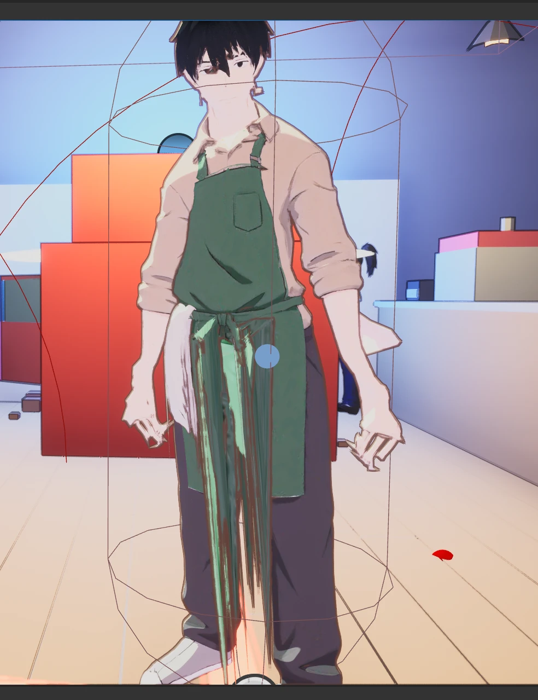

# The apron was tied to a bone on the floor

*Sat 14 Nov 2026, late evening Pacific — GameStation · Blender 5.3.0 · diagnosis and fix by Fable 5.2 (`claude-fable-5-2`)*

- **What we asked for:** the player's new body had long green and white streaks running from his apron's waist
  tie down to a point on the floor between his feet. Find out why, then fix it.

- **Prompts we gave the agent:**

  > can you figure out why this model is distorted like this?

  > If you need to use blender make sure you use Blender 5.3.0. Fix it.

- **What happened:**

  

  **The cause is one bone that is in two places.** On our Meshy rigs the root bone, `Bone_000`, sits at pelvis
  height in the model's rest pose (90.6 cm). Every clip retargeted from Epic's mannequin puts it on the floor and
  lets the hip bone, `Bone_001`, carry the pelvis back up. Measured in the running game: root at **4.2 cm**, hip at
  **88.9 cm**. So any vertex that is weighted to the root is pulled toward the floor by its root weight times
  about 90 cm.

  **The new body had 296 such vertices**, all at the front of the waist, 12 of them more than 80% on the root.
  A vertex 100% on the root drops the full 90 cm; one at 40% drops 36 cm. That is exactly a fan of streaks of
  different lengths from the waist tie to the floor.

  **The old body had the same flaw and nobody saw it.** 181 vertices, none above 29%, a pull of 26 cm at worst,
  hidden inside its skirt-shaped apron. The re-skin made it loud: where the new flat apron had no matching surface
  on the old body, `reskin_to_existing_rig.py` gives a vertex wholly to the bone it is nearest, and at the front of
  the waist the nearest bone is the root.

  **The fix:** `Art/Blender/root_weight_to_hip.py` moves every bit of root weight onto the hip bone, which starts
  in the same place and stays at the pelvis in every clip. 2,995 vertices, 218 total weight. Its `verify` mode
  then compares the file before and after and refuses unless only the weights changed: same 27,791 vertices (none
  moved more than 0.00001 cm), same UVs, same 69 bones in the same rest pose, same material and textures, zero
  weight left on the root, every vertex still summing to 1. Re-imported over the asset `BP_Player` wears with the
  existing `tools/unreal_reimport_char_v2.py save`. The same step now sits inside `rebuild_walker_v2.py` and
  `reskin_to_existing_rig.py`, so rebuilding the body cannot bring it back.

  

  **Checked in the running game** from the game camera turned to his front: standing in the cafe and walking out
  to the street, no streaks.

  **A second fix was tried and thrown away.** The waist tie still shows a small patch of speckles in the game
  that is not there in the rest pose. The guess was that the apron's three layers of cloth carry different leg
  weights and slide through each other, so a script gave the whole apron leg weights by position. Test renders in
  a stride pose showed the thigh coming straight through the apron panel, worse than before, and the speckle
  could not be reproduced in Blender at all, so the guess was never proven. The script was deleted. The speckle
  is still there.

  **The same weights exist on other characters.** A scan of every committed body: the coworker's new body has 114
  vertices over 20% on her root, the crash driver 83. They do not show today because their own clips keep the
  root at the pelvis; they would the moment a mannequin-retargeted clip is played on them.

- **What we learned:**
  - On a rig whose root is not on the floor in its rest pose, **nothing should be weighted to the root**. Check it
    with a number, per body, before import.
  - A weight fault can hide in the first model and only show when the clothes change shape.
  - Test a fix in the pose that breaks it before shipping it. The pose test is what stopped the second "fix".

- **Not done:** nobody has played this with a keyboard. The tie speckle is open. An import warning appeared
  ("Imported skeleton has some invalid bind poses. Skeletal mesh skinning has been rebind using the time zero
  pose"); the body looks right standing and walking, and whether earlier imports logged the same line is unknown
  because they ran on another PC.
